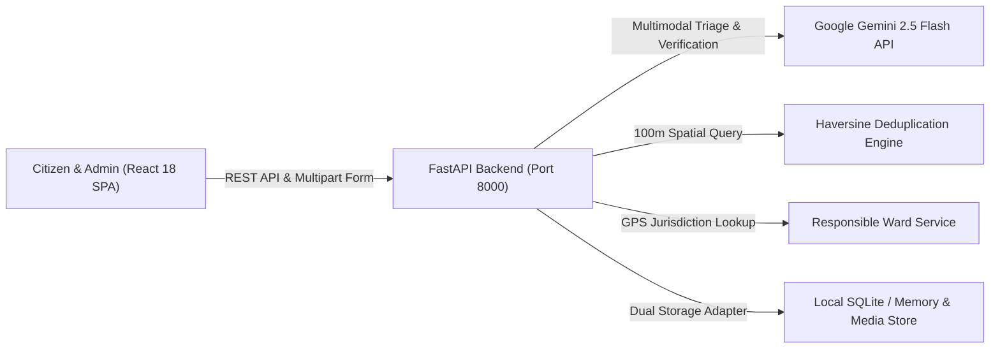

# CivicSetu — AI-Powered Civic Issue Resolution for Indian Cities
*Built for PromptWars (CivicResolve Challenge).*

[](https://www.python.org/)
[](https://fastapi.tiangolo.com/)
[](https://react.dev/)
[](https://ai.google.dev/)

> **Live Deployment:** `[LIVE_DEMO_URL]`  
> *(Note: Use the top-navigation `Admin Portal ↗` and `Report Issue` buttons to switch between citizen reporting and the municipal command center instantly).*

CivicSetu is an end-to-end civic resolution platform engineered for Indian urban local bodies across Karnataka, Telangana, Andhra Pradesh, and Tamil Nadu. It ingests code-mixed voice notes and photos from citizens, performs Gemini-powered multimodal triage and 100-meter spatial-semantic deduplication, maps the defect directly to the responsible local ward office with navigation links, and enforces verified visual resolution audits prior to ticket closure.

---

## 1. The Problem (Indian Civic Context)

Indian municipal infrastructure management faces structural breakdowns across the defect lifecycle:

* **Reporting Friction & Language Barriers:** Standard government portals demand complex form fields, manual ward selection, and formal English descriptions, alienating citizens speaking Kannada, Telugu, Tamil, or Hinglish.
* **Jurisdictional Fragmentation:** Road craters, leaking mains, and dangling wires trigger inter-agency finger-pointing among Urban Local Bodies (BBMP, GHMC, GCC), State PWDs, NHAI, Electricity DISCOMs (BESCOM, TGSPDCL), and Water Boards (BWSSB, HMWSSB).
* **Duplicate Flooding:** High-visibility defects generate dozens of repetitive complaints, overwhelming ward engineers with redundant tickets and obscuring genuine emergency escalations.
* **Unverified Closures:** Contractors routinely mark tickets resolved without physical evidence or upload unrelated photos to clear SLA metrics, eroding citizen confidence.

---

## 2. Feature Matrix & Problem Statement Alignment

| CivicResolve Requirement | CivicSetu Implementation | Key Technical Differentiator |
| :--- | :--- | :--- |
| **Citizen Reporting** | Multi-modal zero-fatigue intake via camera photo, audio voice note, and raw text. | Client EXIF GPS extraction with automatic fallback to network triangulation. |
| **AI Classification** | Multimodal Gemini 2.5 Flash pipeline classifying category, priority, and physical hazards. | Pre-submission visual sanity gate rejecting non-civic media (memes, selfies, indoor blur). |
| **Priority Detection** | Deterministic P0–P3 prioritization with monsoon multipliers and vulnerability proximity flags. | Active school/hospital proximity awareness and severe weather escalation. |
| **Department Routing** | Jurisdiction mapper routing to Municipal ULBs, State PWD, NHAI, DISCOMs, or Water Boards. | GPS-based mapping of responsible Ward/Circle offices, contact helplines, and Google Maps pins. |
| **Issue Deduplication** | Two-tier spatial-semantic engine grouping reports within a 100-meter radius. | Gemini verification merging duplicates into Master Incidents with Community Impact score increments. |
| **Admin Command Center** | Geospatial Leaflet operations map, SLA countdown tickers, and AI briefing generator. | One-click human-in-the-loop dispatch to departments with automatic state transition to `IN_PROGRESS`. |
| **Resolution Verification** | Dual-image Before/After visual comparison audit with strict confidence scoring. | Automated mismatch rejection and a 48-hour citizen reopening window. |

---

## 3. How Google Gemini & Google Antigravity Power CivicSetu

### Google Gemini (`google-genai` SDK)
CivicSetu leverages the official Google GenAI SDK (`google-genai>=1.0.0`) running `gemini-2.5-flash` with strict Pydantic `response_schema` enforcement:
1. **Multimodal Intake Triage:** Combines image bytes, audio notes, and vernacular descriptions into a single round-trip call. It generates standardized English titles and descriptions, extracts physical landmarks, identifies the vernacular language, and outputs a polite local-language acknowledgement.
2. **Spatial-Semantic Deduplication:** When a report falls within 100 meters of an active ticket, Gemini compares the defects to determine whether they represent the identical physical asset failure.
3. **Dual-Image Resolution Audit:** Analyzes contractor post-repair photos side-by-side with original defect photos to verify genuine structural repair before closing the SLA ticket.
4. **Systemic Pattern Synthesis:** Synthesizes cross-ward incident telemetry to generate actionable infrastructure briefings for municipal commissioners.

### Google Antigravity
CivicSetu was architected, scaffolded, and hardened using Google Antigravity. Antigravity enabled rapid end-to-end iteration across FastAPI schemas, Leaflet GIS rendering, Pydantic type safety, and automated test suites within the hackathon timeframe.

---

## 4. System Architecture



### Verified Tech Stack
| Component | Technology | Version |
| :--- | :--- | :--- |
| **Backend Runtime** | Python | 3.12 / 3.14 |
| **API Framework** | FastAPI | >= 0.115.0 |
| **AI SDK** | google-genai | >= 1.0.0 |
| **Schema Validation** | Pydantic v2 | >= 2.10.0 |
| **Frontend Framework** | React + TypeScript + Vite | React 18.3, Vite 5.4 |
| **Mapping & GIS** | Leaflet + React-Leaflet | 1.9.4 |
| **Icons & Styling** | Tailwind CSS + Lucide React | Tailwind 3.4 |

---

## 5. End-to-End Walkthrough

### Citizen View
* **Snap & Speak Intake:** Citizens capture a photo or record a voice note in Kannada, Telugu, Tamil, Hindi, or English. EXIF metadata extracts GPS coordinates automatically.
* **Responsible Ward Identification:** The application displays the responsible local municipal ward (e.g., *Ward 14 - Indiranagar (BBMP East)* or *Circle 20 - Serilingampally (GHMC)*) alongside the ward office address, phone number, and a direct Google Maps navigation link.
* **Community Duplicate Support:** If an issue is already reported within 100m, the citizen can upvote the existing ticket, boosting the community impact score and escalating its priority.
* **Resolution Verification & Reopen:** Citizens view Before and After photos side-by-side with the AI audit confidence score and can reopen rejected repairs within 48 hours.

### Admin Command Center
* **Operational KPI Strip:** Live counters show total active incidents, P0 critical hazards, SLA-overdue tickets, and verified resolution rates.
* **Geospatial Command Map:** Leaflet map displays priority-colored pins across southern municipal zones with quick-jump filters for Karnataka, Telangana, Andhra Pradesh, and Tamil Nadu.
* **Explainable AI Triage Drawer:** Displays the full AI hazard breakdown, monsoon impact flags, statutory jurisdiction rationales, and an editable human-in-the-loop override form.
* **One-Click Department Dispatch:** Allows administrators to generate a structured AI work order and transition the defect to `IN_PROGRESS` with a single click.

---

## 6. API Endpoints Overview

| Method | Endpoint | Purpose |
| :--- | :--- | :--- |
| `POST` | `/api/intake/triage` | Multimodal intake accepting photo, audio voice note, text, and GPS coordinates. |
| `GET` | `/api/intake/responsible-ward` | Finds responsible local municipal Ward/Circle office, phone, and Google Maps pin. |
| `GET` | `/api/intake/nearest-office` | Calculates closest administrative municipal office using Haversine distance. |
| `POST` | `/api/intake/check-duplicate` | Evaluates nearby tickets within 100m for spatial and semantic duplication. |
| `POST` | `/api/intake/submit` | Finalizes report, increments community impact score, or registers a new Master Incident. |
| `GET` | `/api/incidents` | Lists all active master incidents with optional ward, agency, status, and priority filters. |
| `GET` | `/api/incidents/{incident_id}` | Retrieves complete incident details, citizen reports, and explainable AI trace. |
| `PATCH` | `/api/incidents/{id}/override` | Admin human-in-the-loop override for priority, agency, status, or ward assignment. |
| `POST` | `/api/incidents/{id}/work-order` | Generates a structured field crew work order using Gemini. |
| `POST` | `/api/incidents/{id}/resolve` | Submits contractor repair photo and triggers Before/After visual verification audit. |
| `POST` | `/api/incidents/{id}/reopen` | Allows citizens to contest invalid closures within the 48-hour SLA window. |
| `GET` | `/api/analytics/kpi-summary` | Aggregates real-time municipal resolution metrics, P0 counts, and overdue tickets. |
| `POST` | `/api/analytics/systemic-briefing` | Generates an executive briefing identifying cross-ward civic failure clusters. |
| `POST` | `/api/auth/login` | Authenticates citizen or admin credentials and returns session tokens. |
| `POST` | `/api/seed/reset` | Resets repository state with 20 realistic multi-state seed incidents. |

---

## 7. Local Development Setup

### Prerequisites
* Python 3.12+
* Node.js 18+ and npm
* Google AI Studio Gemini API Key

### Installation Steps
```bash
# 1. Clone the repository
git clone https://github.com/uday0214/CivicSetu.git
cd CivicSetu

# 2. Configure environment variables
cp .env.example .env
# Edit .env and supply your GEMINI_API_KEY

# 3. Backend setup
python3 -m venv .venv
source .venv/bin/activate
pip install -r backend/requirements.txt

# 4. Frontend setup
cd frontend
npm install
npm run build
cd ..

# 5. Run tests
pytest -v

# 6. Start the server
uvicorn backend.main:app --host 0.0.0.0 --port 8000
```
Open `http://localhost:8000` in your browser.

### Environment Variables
| Variable | Required | Default | Description |
| :--- | :--- | :--- | :--- |
| `GEMINI_API_KEY` | Yes | — | Google AI Studio API key for Gemini 2.5 Flash. |
| `GEMINI_MODEL` | No | `gemini-2.5-flash` | Pinned Gemini model identifier. |
| `DATA_STORE_MODE` | No | `memory` | `memory` (local dev) or `firestore` (GCP deployment). |
| `PORT` | No | `8000` | HTTP server port. |
| `GOOGLE_CLOUD_PROJECT`| No | `civicsetu-demo` | GCP project ID (for Cloud Run/Firestore). |
| `GCS_BUCKET` | No | `civicsetu-media-us-central1` | Cloud Storage bucket for uploaded media. |

---

## 8. Google Cloud Deployment (Single-Container Architecture)

CivicSetu is containerized as a single multi-stage Docker container that builds the React application and serves both the static UI and FastAPI REST endpoints on port 8000.

### Build and Deploy to Cloud Run
```bash
# Authenticate with Google Cloud
gcloud auth login
gcloud config set project YOUR_GCP_PROJECT_ID

# Build container using Google Cloud Build
gcloud builds submit --tag gcr.io/YOUR_GCP_PROJECT_ID/civicsetu:latest .

# Deploy to Cloud Run (Always-Free Tier eligible)
gcloud run deploy civicsetu \
  --image gcr.io/YOUR_GCP_PROJECT_ID/civicsetu:latest \
  --platform managed \
  --region us-central1 \
  --allow-unauthenticated \
  --set-env-vars GEMINI_API_KEY=YOUR_GEMINI_KEY,DATA_STORE_MODE=memory
```

---

## 9. Project Structure

```text
civicSetu/
├── backend/
│   ├── config.py                 # Pydantic environment settings
│   ├── main.py                   # FastAPI initialization and static SPA mounting
│   ├── models/                   # Canonical Pydantic schemas and Indian enums
│   │   ├── dedup.py
│   │   ├── enums.py
│   │   ├── intake.py
│   │   └── schemas.py
│   ├── routes/                   # REST route handlers
│   │   ├── analytics.py
│   │   ├── auth.py
│   │   ├── incidents.py
│   │   └── intake.py
│   ├── services/                 # Gemini clients and domain logic
│   │   ├── audit_service.py
│   │   ├── dedup_service.py
│   │   ├── gemini_client.py
│   │   ├── geo_office_service.py
│   │   ├── intake_service.py
│   │   └── responsible_ward_service.py
│   └── storage/                  # SQLite, In-Memory, and Media adapters
├── frontend/
│   ├── src/
│   │   ├── components/           # Citizen intake, Map, and Admin command components
│   │   │   ├── admin/
│   │   │   ├── citizen/
│   │   │   └── common/
│   │   ├── services/             # Type-safe API client
│   │   ├── types/                # Snake_case TypeScript API contracts
│   │   └── App.tsx               # Top-to-bottom citizen and admin flow
│   ├── index.html
│   └── package.json
├── tests/                        # Comprehensive Pytest suite
├── Dockerfile                    # Multi-stage production container
└── pytest.ini
```
