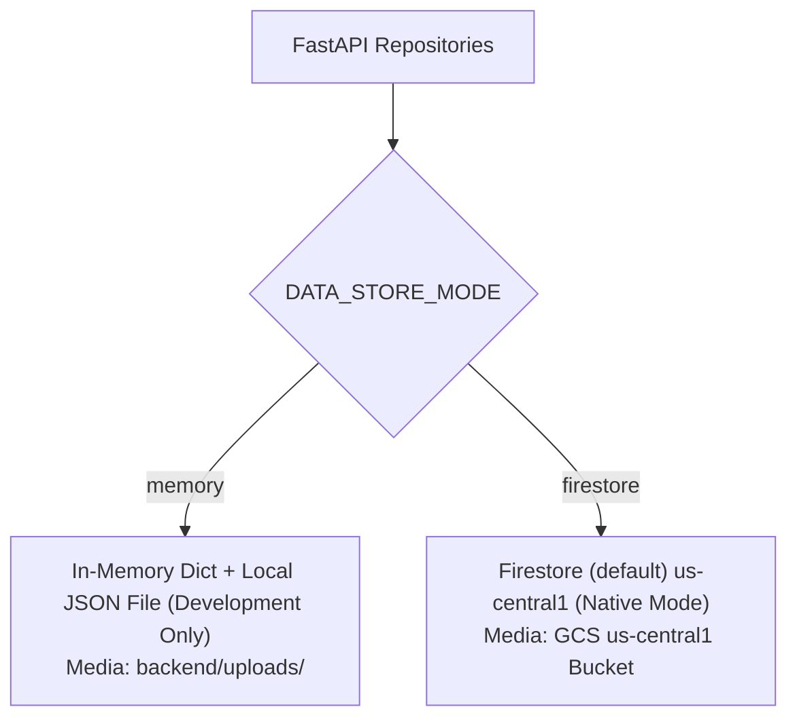
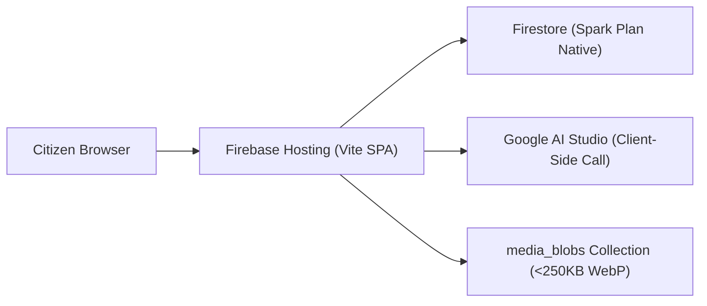

# CivicSetu — Infrastructure, API & GCP Always Free Specification (`INTEGRATIONS.md`)

This document is the authoritative infrastructure, API, and Google Cloud Platform deployment specification for **CivicSetu**. Every architectural decision, SDK call, and CLI command documented here strictly enforces **₹0 / $0 Always Free tier operation** (without relying on temporary $300 trial credits).

---

## 1. Non-Negotiable GCP Always Free Guardrails

All infrastructure, code, and deployment scripts must strictly comply with these hard architectural constraints:

| Guardrail | Mandatory Requirement | Failure Mode Prevented |
| :--- | :--- | :--- |
| **Single Region Lock (`us-central1`)** | Every GCP resource (Cloud Run, Firestore, Cloud Storage, Artifact Registry) **MUST** be deployed in `us-central1` (regional, never multi-region `US` and never `asia-south1`). | Multi-region storage and non-US regions do not qualify for the 5 GB Always Free storage tier and incur cross-region egress charges. |
| **No Vertex AI** | All LLM, vision, and audio processing **MUST** use the **Google AI Studio Gemini API** (Free Tier) via the official `google-genai` Python SDK (`from google import genai`). Never import or configure `vertexai` or legacy `google-generativeai`. | Vertex AI charges per-character/per-token without an Always Free tier. |
| **No `gcloud run deploy --source .`** | **Banned:** Never run source-based Cloud Run builds. Always build the container locally with Docker and push directly to Artifact Registry. | Cloud Build automatically creates a multi-region staging storage bucket outside the Always Free quota, triggering unexpected billing. |
| **No Idle Compute** | Cloud Run **MUST** be provisioned with `--min-instances=0`, `--max-instances=2`, `--memory=512Mi`, `--cpu=1`, and `--cpu-throttling` (request-based billing). | Non-zero min-instances run 24/7, burning through the 2 million free monthly request quota and compute seconds. |
| **Artifact Registry Cap (< 0.5 GB)** | Keep final Docker image strictly **under 200 MB** using multi-stage builds. Apply a cleanup policy retaining only the **2 most recent image versions** and deleting older untagged digests after 1 hour. | Artifact Registry provides 0.5 GB/month free storage; unpruned images trigger ongoing monthly storage charges. |

---

## 2. Service-by-Service Integration Specifications

### 2.1 Gemini Multimodal Engine (Google AI Studio Free Tier)
- **SDK & Model Pinning:** Exclusively use the official `google-genai` Python SDK (`from google import genai`). Pin the model name in `.env` (`GEMINI_MODEL=gemini-2.5-flash` or `gemini-3.8-flash`)—never hardcode model strings across service files.
- **Native Structured Outputs:** Enforce native `response_mime_type="application/json"` with `response_schema=<PydanticModel>` for all Gemini endpoints:
  - Unified Intake & Sanity Gate (`IntakeTriageResponse`)
  - Spatial-Semantic Deduplication (`DedupComparisonResponse`)
  - Closed-Loop Resolution Audit (`ResolutionAuditResponse`)
  - Field Work Order Generation (`WorkOrderResponse`)
  - Macro Systemic Briefing (`SystemicBriefingResponse`)
  *Never parse Gemini JSON outputs via regex or markdown strip helpers.*
- **Browser-Native Audio & Vision Intake:** Accept `audio/webm`, `audio/mp4`, and `audio/wav` natively from the browser's `MediaRecorder` API and pass the MIME type directly to the Gemini API. Require client-side EXIF GPS extraction (`exifr`) *before* canvas compression (`<= 1024px` JPEG/WebP).
- **Quota & Demo Circuit Breaker:** Centralize all Gemini API calls into a single helper module (`backend/services/gemini_client.py`):
  - 1-retry exponential backoff for transient `429` rate-limit errors.
  - A `DEMO_FALLBACK_ON_QUOTA=true` environment setting that intercepts rate limits or network dropouts mid-pitch and returns deterministic, schema-valid fixture JSON matching the seed incidents.

### 2.2 Dual-Mode Persistence (`DATA_STORE_MODE`)
CivicSetu supports two persistence strategies controlled by the `DATA_STORE_MODE` environment variable:



- **`memory` Mode (Local Development Only):**
  - Stores incidents and reports in-memory backed by a local JSON file for rapid offline development.
  - Media saved to `backend/uploads/` and served via FastAPI static mount.
  - *Explicit Warning:* Cloud Run container filesystems are ephemeral and reset whenever instances scale to zero. `memory` mode must **never** be used in production.
- **`firestore` Mode (Cloud Run Production):**
  - Target the **`(default)`** database in Firestore Native mode located strictly in `us-central1`.
  - Disable Point-in-Time Recovery (PITR) and automated backups to prevent storage overages.
  - Paginate all Admin Dashboard list queries (e.g., `limit=25`) to stay far below the 50,000 reads/day and 20,000 writes/day Always Free quotas.
  - **Hard Rule:** Forbid storing raw base64 image strings inside Firestore documents. Documents must store only metadata and media URL references, preventing document cap exhaustion (1 MiB limit).

### 2.3 Media Storage Architecture (`MediaStorageAdapter`)
All media uploads (citizen issue photos, voice notes, and contractor resolution photos) flow through an abstract storage interface:

```python
class MediaStorageAdapter(ABC):
    @abstractmethod
    async def save_bytes(self, data: bytes, mime_type: str, filename_prefix: str = "") -> str:
        """Saves binary media and returns a servable URL."""
        pass
```

- **Local Development Implementation (`LocalMediaStorage`):** Writes files to `backend/uploads/` and returns `/uploads/<uuid>.<ext>`.
- **Cloud Run Production Implementation (`GCSMediaStorage`):** Uploads to the regional `us-central1` Cloud Storage bucket (`GCS_BUCKET`, Standard storage class, uniform bucket-level access) and returns `https://storage.googleapis.com/<bucket>/<uuid>.<ext>`, operating comfortably within the 5 GB Always Free tier.
- **Seed Image Protection:** Forbid hallucinated external image URLs (e.g. Unsplash) in Section 8's seed dataset. All seed photos are stored locally under `frontend/public/seed/` (`/seed/pothole_waterlogged.jpg`, `/seed/pothole_repaired.jpg`) so demos run with 100% asset reliability.

### 2.4 Secret Manager & Least-Privilege IAM
- Store the Gemini API key in **Google Cloud Secret Manager** as secret `GEMINI_API_KEY`.
- Secret Manager includes 6 active secret versions and 10,000 access operations per month in the Always Free tier.
- Mount the secret directly into Cloud Run at deployment time via `--set-secrets="GEMINI_API_KEY=GEMINI_API_KEY:latest"`.
- Assign only the following least-privilege IAM roles to the Cloud Run runtime service account (`<project-number>-compute@developer.gserviceaccount.com` or custom service account):
  - `roles/secretmanager.secretAccessor` (access API key)
  - `roles/datastore.user` (read/write Firestore documents)
  - `roles/storage.objectAdmin` (scoped strictly to the media bucket `GCS_BUCKET`)

### 2.5 Single-Container Cloud Run Serving
To eliminate CORS headaches, multiple domains, and extra service costs, CivicSetu is packaged as a single unified container:

```dockerfile
# Stage 1: Build Frontend SPA
FROM node:20-alpine AS frontend-builder
WORKDIR /app/frontend
COPY frontend/package*.json ./
RUN npm ci
COPY frontend/ ./
RUN npm run build

# Stage 2: Production Python Runtime
FROM python:3.12-slim
WORKDIR /app
ENV PYTHONUNBUFFERED=1 \
    PORT=8080 \
    DATA_STORE_MODE=firestore
COPY backend/requirements.txt ./
RUN pip install --no-cache-dir -r requirements.txt
COPY backend/ ./backend
COPY --from=frontend-builder /app/frontend/dist ./frontend/dist
EXPOSE 8080
CMD ["uvicorn", "backend.main:app", "--host", "0.0.0.0", "--port", "8080"]
```

FastAPI routing structure & Catch-All Protection:
- `/api/*`: Dynamic API routes (triage, deduplication, resolution audit, analytics). All endpoints strictly accept and return **`snake_case`** JSON payloads (`incident_id`, `master_incident_id`, `community_impact_score`, `escalation_tier`, `audit_status`, `visual_hazard_factors`, etc.) matching `docs/FRONTEND.md` and `docs/CONTEXT.md`.
- `/uploads/*`: Local static uploads (in `memory` mode).
- `/seed/*`: Local static seed photos under `frontend/public/seed/`.
- `/`: Static files mount pointing to `frontend/dist`.
- `/{full_path:path}`: SPA catch-all returning `frontend/dist/index.html` for client-side routing.
  - **Catch-All Route Guard:** The catch-all route **MUST explicitly exclude** `/api/*`, `/uploads/*`, and `/seed/*` (or any path with a file extension). Requests to `/api/*`, `/uploads/*`, or `/seed/*` that do not match a route must raise a true HTTP 404 rather than returning `index.html`:
  ```python
  @app.get("/{full_path:path}")
  async def serve_spa(full_path: str):
      if full_path.startswith(("api/", "uploads/", "seed/")):
          raise HTTPException(status_code=404, detail="Endpoint not found")
      file_path = os.path.join("frontend/dist", full_path)
      if os.path.isfile(file_path):
          return FileResponse(file_path)
      return FileResponse("frontend/dist/index.html")
  ```

---

## 3. Required Environment Variables

| Variable | Required In | Default (Local) | Cloud Run Production Value | Description |
| :--- | :--- | :--- | :--- | :--- |
| `GEMINI_API_KEY` | Both | `""` (Set in `.env`) | Mounted from Secret Manager | Google AI Studio Gemini API key. |
| `GEMINI_MODEL` | Both | `gemini-2.5-flash` | `gemini-2.5-flash` | Pinned Gemini model identifier. |
| `DATA_STORE_MODE` | Both | `memory` | `firestore` | Persistence engine selector. |
| `GOOGLE_CLOUD_PROJECT` | Prod | `""` | e.g. `civicsetu-prod` | Google Cloud project ID. |
| `GCS_BUCKET` | Prod | `""` | e.g. `civicsetu-media-us-central1` | Regional `us-central1` Cloud Storage bucket. |
| `DEMO_FALLBACK_ON_QUOTA`| Both | `false` | `true` | Circuit breaker for live pitch resilience. |
| `PORT` | Both | `8000` | `8080` | HTTP port for Uvicorn server. |

---

## 4. Exact Provisioning & Deployment Commands

Run these verified CLI commands in order from your local terminal:

### Step 4.1: Set Project & Enable Only 5 Required Free-Tier APIs
```bash
export PROJECT_ID="civicsetu-$(date +%s | tail -c 5)"
export REGION="us-central1"

gcloud config set project "$PROJECT_ID"

# Enable exclusively the 5 Always Free service APIs
gcloud services enable \
  run.googleapis.com \
  firestore.googleapis.com \
  storage.googleapis.com \
  artifactregistry.googleapis.com \
  secretmanager.googleapis.com
```

### Step 4.2: Provision Firestore, Storage & Artifact Registry
```bash
# 1. Create (default) Firestore database in Native mode (strictly us-central1)
gcloud firestore databases create \
  --location="$REGION" \
  --type=firestore-native

# 2. Create regional Cloud Storage bucket (Standard class, uniform access)
export BUCKET_NAME="civicsetu-media-${PROJECT_ID}"
gcloud storage buckets create "gs://${BUCKET_NAME}" \
  --location="$REGION" \
  --default-storage-class=STANDARD \
  --uniform-bucket-level-access

# Allow public read on media objects (or serve via signed URLs)
gcloud storage buckets add-iam-policy-binding "gs://${BUCKET_NAME}" \
  --member="allUsers" \
  --role="roles/storage.objectViewer"

# 3. Create Artifact Registry Docker repository
gcloud artifacts repositories create civicsetu-repo \
  --repository-format=docker \
  --location="$REGION" \
  --description="CivicSetu single container images"
```

### Step 4.3: Apply Artifact Registry Cleanup Policy (< 0.5 GB Cap)
Create `cleanup-policy.json`:
```json
{
  "rules": [
    {
      "name": "keep-recent-two-versions",
      "action": {"type": "Keep"},
      "mostRecentVersions": {
        "keepCount": 2
      }
    },
    {
      "name": "delete-old-untagged",
      "action": {"type": "Delete"},
      "condition": {
        "tagState": "UNTAGGED",
        "olderThan": "3600s"
      }
    }
  ]
}
```
Apply the policy:
```bash
gcloud artifacts repositories set-cleanup-policies civicsetu-repo \
  --location="$REGION" \
  --policy=cleanup-policy.json
```

### Step 4.4: Store Gemini API Key in Secret Manager
```bash
echo -n "YOUR_GEMINI_API_KEY_HERE" | gcloud secrets create GEMINI_API_KEY \
  --data-file=- \
  --replication-policy="automatic"
```

### Step 4.5: Build Locally & Push Docker Image (< 200 MB)
```bash
# Configure Docker authentication for Artifact Registry
gcloud auth configure-docker "${REGION}-docker.pkg.dev"

export IMAGE_TAG="${REGION}-docker.pkg.dev/${PROJECT_ID}/civicsetu-repo/civicsetu:v1"

# Build locally (avoids Cloud Build staging bucket charges)
docker build -t "$IMAGE_TAG" -f Dockerfile .

# Verify image size is strictly under 200 MB
docker images "$IMAGE_TAG" --format "{{.Repository}}:{{.Tag}} size is {{.Size}}"

# Push image directly
docker push "$IMAGE_TAG"
```

### Step 4.6: Deploy Single Container to Cloud Run (Always Free Flags)
```bash
gcloud run deploy civicsetu \
  --image="$IMAGE_TAG" \
  --region="$REGION" \
  --platform=managed \
  --allow-unauthenticated \
  --min-instances=0 \
  --max-instances=2 \
  --memory=512Mi \
  --cpu=1 \
  --cpu-throttling \
  --set-env-vars="DATA_STORE_MODE=firestore,GOOGLE_CLOUD_PROJECT=${PROJECT_ID},GCS_BUCKET=${BUCKET_NAME},DEMO_FALLBACK_ON_QUOTA=true,GEMINI_MODEL=gemini-2.5-flash" \
  --set-secrets="GEMINI_API_KEY=GEMINI_API_KEY:latest"
```

### Step 4.7: Setup ₹10 / $0.10 Billing Budget Alert Safety Net
```bash
# Ensure billing account budget sends alerts immediately if any non-free SKU charges
gcloud billing budgets create \
  --billing-account="YOUR_BILLING_ACCOUNT_ID" \
  --display-name="CivicSetu Zero-Cost Guardrail" \
  --budget-amount=10INR \
  --threshold-rule=percent=0.5 \
  --threshold-rule=percent=1.0
```

---

## 5. Zero-Billing-Account Fallback (Spark Plan Mode)

If deploying to GCP without linking a credit card or billing account, CivicSetu supports the **Firebase Spark Plan Fallback**:



1. **Hosting:** Deploy the Vite SPA to **Firebase Hosting** (Always Free on Spark Plan).
2. **Database & Media:**
   - Store incident documents in **Firestore** (Spark Plan).
   - For media storage without Cloud Storage buckets: Compress images client-side to `< 250 KB` WebP and store them in a separate `media_blobs/{media_id}` Firestore collection with chunked base64 (strictly outside the main incident document to respect the 1 MiB doc limit).
3. **AI Inference:**
   - Direct frontend calls to Google AI Studio Gemini API (`gemini-2.5-flash`).
   - Restrict the Gemini API key in Google Cloud Console strictly by HTTP referrer to your `.web.app` / `.firebaseapp.com` domains.

---

## 6. Pre-Deploy Verification Checklist

Before submitting or pitching CivicSetu, verify all checklist items:

- [ ] **Image Size:** `docker images` confirms the built container image size is `< 200 MB`.
- [ ] **Regional Isolation:** `gcloud storage buckets describe gs://${BUCKET_NAME}` confirms `location: US-CENTRAL1` and `locationType: region`.
- [ ] **Firestore Mode:** `(default)` Firestore database is in Native mode and in `us-central1`.
- [ ] **Lifecycle Policy:** Artifact Registry cleanup policy is active with `keepCount: 2`.
- [ ] **Frontend Compile:** `cd frontend && tsc --noEmit && npm run build` completes with zero errors.
- [ ] **Backend Tests:** `pytest` passes 100% of API and schema tests in both `memory` and `firestore` modes.
- [ ] **Live Smoke Test:** Opening the deployed `.run.app` URL:
  - Submits a photo + audio report without browser console errors.
  - Successfully writes 1 document to Firestore and 1 image to GCS `us-central1`.
  - Displays instant single-call triage, Explainable AI trace, and vernacular response with zero CORS errors.
