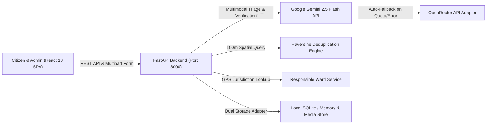

# CivicSetu — Technical Reference & Architecture Specification

This document contains deep technical details, verified system architecture, complete REST API route contracts, and project directory structure for **CivicSetu**.

---

## 1. System Architecture



### Verified Tech Stack
| Component | Technology | Version |
| :--- | :--- | :--- |
| **Backend Runtime** | Python | 3.12 / 3.14 |
| **API Framework** | FastAPI | >= 0.115.0 |
| **AI SDK** | google-genai | >= 1.0.0 |
| **AI Fallback** | OpenRouter HTTP Client | HTTPX 0.28+ |
| **Schema Validation** | Pydantic v2 | >= 2.10.0 |
| **Database** | SQLite / JSON Store | Python Standard Library |
| **Frontend Framework** | React + TypeScript + Vite | React 18.3, Vite 5.4 |
| **Mapping & GIS** | Leaflet + React-Leaflet | 1.9.4 |
| **Styling** | Tailwind CSS + Lucide React | Tailwind 3.4 |

---

## 2. API Endpoints Overview

| Method | Endpoint | Purpose |
| :--- | :--- | :--- |
| `POST` | `/api/intake/triage` | Multimodal intake accepting photo, audio voice note, text, and GPS coordinates. |
| `GET` | `/api/intake/responsible-ward` | Finds responsible local municipal Ward/Circle office, phone, and Google Maps pin. |
| `GET` | `/api/intake/nearest-office` | Calculates closest administrative municipal office using Haversine distance. |
| `POST` | `/api/intake/check-duplicate` | Evaluates nearby tickets within 100m for spatial and semantic duplication. |
| `POST` | `/api/intake/submit` | Finalizes report, increments community impact score, or registers a new Master Incident. |
| `GET` | `/api/incidents` | Lists all active master incidents with optional ward, agency, status, and priority filters. |
| `GET` | `/api/incidents/{incident_id}` | Retrieves complete incident details, citizen reports, and explainable AI trace. |
| `PATCH` | `/api/incidents/{id}/override` | Admin human-in-the-loop override for priority, agency, status, or ward assignment. |
| `POST` | `/api/incidents/{id}/work-order` | Generates a structured field crew work order using Gemini. |
| `POST` | `/api/incidents/{id}/resolve` | Submits contractor repair photo and triggers Before/After visual verification audit. |
| `POST` | `/api/incidents/{id}/reopen` | Allows citizens to contest invalid closures within the 48-hour SLA window. |
| `GET` | `/api/analytics/kpi-summary` | Aggregates real-time municipal resolution metrics, P0 counts, and overdue tickets. |
| `POST` | `/api/analytics/systemic-briefing` | Generates an executive briefing identifying cross-ward civic failure clusters. |
| `POST` | `/api/auth/login` | Authenticates citizen or admin credentials and returns session tokens. |
| `POST` | `/api/seed/reset` | Resets repository state with 20 realistic multi-state seed incidents. |

---

## 3. Project Structure

```text
civicSetu/
├── backend/
│   ├── config.py                 # Pydantic environment settings
│   ├── main.py                   # FastAPI initialization and static SPA mounting
│   ├── models/                   # Canonical Pydantic schemas and Indian enums
│   │   ├── admin.py
│   │   ├── audit.py
│   │   ├── auth.py
│   │   ├── dedup.py
│   │   ├── enums.py
│   │   ├── intake.py
│   │   └── schemas.py
│   ├── routes/                   # REST route handlers
│   │   ├── analytics.py
│   │   ├── assets.py
│   │   ├── auth.py
│   │   ├── health.py
│   │   ├── incidents.py
│   │   ├── intake.py
│   │   └── seed.py
│   ├── services/                 # Gemini clients and domain logic
│   │   ├── admin_service.py
│   │   ├── audit_service.py
│   │   ├── dedup_service.py
│   │   ├── gemini_client.py
│   │   ├── geo_office_service.py
│   │   ├── intake_service.py
│   │   ├── openrouter_client.py
│   │   ├── responsible_ward_service.py
│   │   └── seed_data.py
│   └── storage/                  # SQLite, In-Memory, and Media adapters
├── frontend/
│   ├── src/
│   │   ├── components/           # Citizen intake, Map, and Admin command components
│   │   │   ├── admin/
│   │   │   ├── auth/
│   │   │   ├── citizen/
│   │   │   ├── common/
│   │   │   └── layout/
│   │   ├── services/             # Type-safe API client
│   │   ├── types/                # Snake_case TypeScript API contracts
│   │   └── App.tsx               # Top-to-bottom citizen and admin flow
│   ├── index.html
│   └── package.json
├── docs/                         # Documentation, guides, and agent specifications
├── tests/                        # Comprehensive Pytest suite (51 tests)
├── Dockerfile                    # Multi-stage production container
├── render_build.sh               # Automated Render build script
├── Procfile                      # Render start command specification
└── pytest.ini
```
