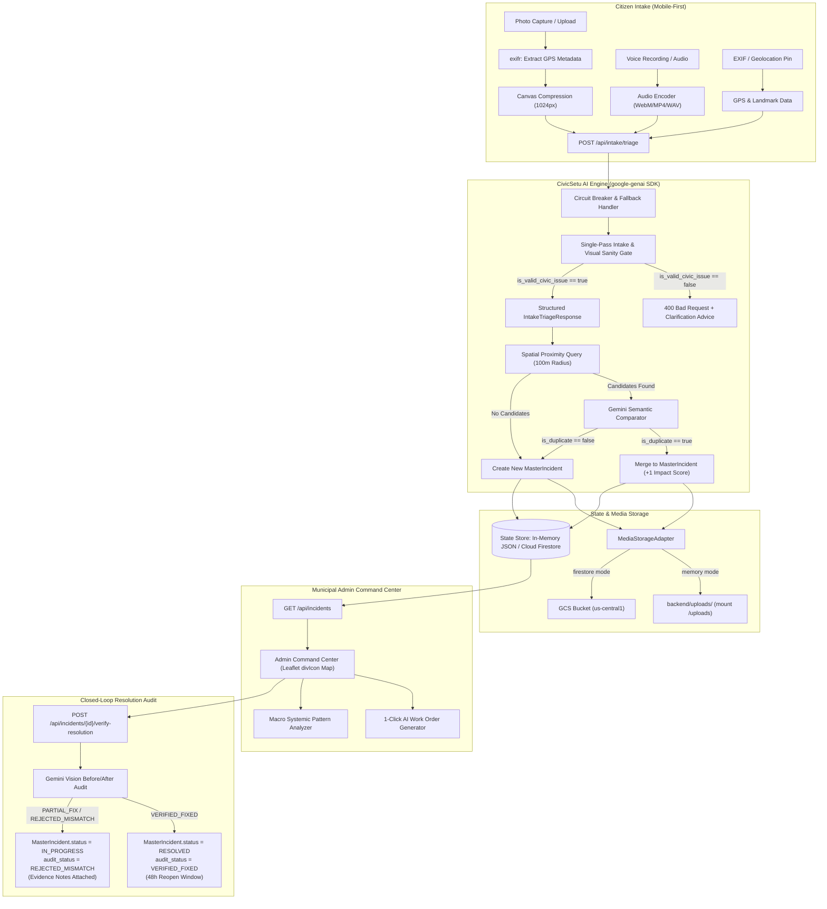

# CivicSetu (CivicResolve for Indian Cities) — System Context & Architecture

> **MANDATORY EXECUTION RULE: SECTION-END BUILD GATES**
> 
> After completing any numbered section (Sections 1 through 9 of `ROADMAP.md`), the engineering agent must run both validation checks before declaring the section complete:
> 1. `tsc --noEmit` (or `npm run build`) in `frontend/`
> 2. FastAPI import & smoke check in `backend/`: `python -c "import backend.main"`
> 
> No section may be marked complete if either command produces errors or broken imports.

---

## 0. Seven Critical Engineering Guardrails

To prevent production build failures, API boundary bugs, demo quota crashes, and storage bottlenecks, all implementation must comply with these 7 engineering guardrails:

| # | Guardrail | Enforcement Mandate | Failure Mode Prevented |
| :- | :--- | :--- | :--- |
| **1** | **Section-End Build Gates** | Run `tsc --noEmit` in `frontend/` and `python -c "import backend.main"` in `backend/` at the end of each roadmap section. | Compounding broken imports and cascading TypeScript errors. |
| **2** | **Native Structured Outputs & Env-Pinned Model** | Strictly use official `google-genai` SDK (`from google import genai`) with `response_mime_type="application/json"` and `response_schema=<PydanticModel>`. Pin model in `.env` (`GEMINI_MODEL=gemini-2.5-flash` or `gemini-3.8-flash`). | Regex parsing failures, markdown fence stripping, and scattered hardcoded model strings. |
| **3** | **Lock Wire-Format Casing (snake_case Everywhere)** | Mandate `snake_case` verbatim across BOTH Python Pydantic models and TypeScript interfaces (`community_impact_score`, `master_incident_id`, `citizen_report_ids`, `escalation_tier`). | Silent `undefined` UI bugs from camelCase/snake_case mismatch at API boundaries. |
| **4** | **Abstract Image Storage Away from Firestore** | Forbid storing base64 image strings in Firestore documents. Implement `MediaStorageAdapter` (`save_bytes(data, mime_type) -> str`): local `backend/uploads/` (static mount `/uploads`) in `memory` mode; GCS `us-central1` bucket in `firestore` mode. | Hitting Firestore 1 MiB document limit when merging multiple reports or Before/After photos. |
| **5** | **Ban Default Leaflet Marker PNGs** | Forbid default Leaflet marker PNG URLs (`marker-icon.png`). Mandate custom HTML/SVG `L.divIcon` pins with Tailwind color-coding for P0–P3. | Broken image box icon rendering caused by Vite production build asset URL hashing/rewriting. |
| **6** | **Forbid Hallucinated External URLs in Seed Data** | Forbid external Unsplash / placeholder URLs that 404 during pitches. Store all seed photos locally under `frontend/public/seed/` (e.g., `/seed/pothole_waterlogged.jpg`, `/seed/pothole_repaired.jpg`). | Broken image tiles or network 404s during live judging demonstrations. |
| **7** | **429 / Offline Circuit Breaker for Demos** | Wrap all Gemini calls in a helper with 1-retry exponential backoff and a `DEMO_FALLBACK_ON_QUOTA=true` environment setting returning deterministic, schema-valid fixture JSON on 429 quota exhaustion or network timeout. | Live demo crashes due to free-tier Gemini API RPM quota limits or spotty hackathon Wi-Fi. |

---

## 0.1. Document Hierarchy & Specification Authority

To ensure total architectural consistency across development phases, all code scaffolding and review must adhere to this document authority hierarchy:

| Document | Authority Domain | Covered Sections |
| :--- | :--- | :--- |
| **[`ROADMAP.md`](ROADMAP.md)** | **Authoritative Execution Checklist:** Defines the step-by-step sequential delivery, technical deliverables, and acceptance criteria for all 9 sections. | Sections 1 – 9 |
| **[`CONTEXT.md`](CONTEXT.md)** | **Authoritative Architecture & Data Model:** Defines system architecture, canonical Pydantic schemas, Indian agency jurisdiction hierarchy, Gemini prompt contracts, and the 7 engineering guardrails. | Systemwide |
| **[`FRONTEND.md`](FRONTEND.md)** | **Authoritative UI/UX & Client Design:** Governs all visual tokens, Tailwind palettes, Indic typography, mobile-first citizen layouts, desktop split-screen GIS command center, custom SVG `L.divIcon` markers, and component layouts. | Section 1.4 (Role Switcher)<br/>Section 6 (Citizen Experience)<br/>Section 7 (Admin Command Center) |
| **[`INTEGRATIONS.md`](INTEGRATIONS.md)** | **Authoritative Infrastructure & Always Free Spec:** Governs single-container Docker packaging, GCP `us-central1` Always Free quotas, CLI provisioning commands, Secret Manager IAM, and the SPA catch-all route exclusions. | Section 1.3 (Storage Adapter)<br/>Section 9.2 (Cloud Run Dockerfile) |

---

## 1. Executive Summary & Problem Statement

### 1.1 The Challenge: PromptWars — CivicResolve
Everyday civic issues—such as deep potholes, overflowing garbage dumps, non-functional streetlights, open stormwater drains, sewage overflows, and broken water mains—severely degrade community safety and urban living quality across Indian cities.

Traditional municipal reporting apps (e.g., Swachhata, BBMP Sahaya, grievance portals) fail due to two structural bottlenecks:
1. **Citizen Reporting Friction:** Rigid 6-to-8 field forms, language barriers (English-only portals), forced manual category/department selection (which citizens do not know), and lack of citizen trust caused by silent ticket closures without proof.
2. **Municipal Admin Overload & Fragmentation:** Hundreds of redundant reports for the same incident flood ward offices without spatial clustering. Black-box priority assignments give engineers zero context on immediate public danger. Complex jurisdictional overlaps between municipal corporations (ULB), state public works (PWD), highway authorities (NHAI), and utilities (DISCOM / Water Board) cause tickets to bounce between departments for weeks.

### 1.2 The CivicSetu Solution
**CivicSetu** (*Setu* = Bridge) bridges citizens and municipal authorities through agentic, multimodal AI powered by **Google Gemini**:
- **Zero-Friction "Snap & Speak" Multimodal Intake:** Citizens take a photo and/or speak naturally in their native language (Hindi, Telugu, Kannada, Tamil, Hinglish, etc.). Gemini extracts structured English fields, assesses severity, and acknowledges the citizen in their own dialect.
- **Spatial-Semantic Deduplication:** New reports within 100 meters are semantically compared with existing active tickets by Gemini. Duplicates automatically merge into a single **Master Incident** while incrementing a **Community Impact Score**, escalating priority without inbox noise.
- **Explainable AI Triage & Indian Agency Routing:** Transparent reasoning breakdown detailing physical hazards, monsoon vulnerability multipliers, and precise routing across municipal layers (e.g. Ward 14 PWD vs BBMP vs BESCOM).
- **Closed-Loop Resolution Audit:** Field repair photos are compared against original citizen complaint photos by Gemini Vision. Fake closures (e.g., gravel poured into an unpaved pothole or photos of unrelated sites) are rejected automatically before tickets can be closed.
- **Systemic Macro Briefings:** Gemini synthesizes cross-ward incident patterns to detect root-cause infrastructure failures (e.g., recurring potholes along an entire 2 km stretch indicating a collapsed stormwater culvert).

---

## 2. Indian Municipal Reality & Jurisdiction Matrix

In Indian cities, civic complaints stall because citizens assign tickets to the wrong administrative entity. CivicSetu resolves this by embedding real Indian governance structures into Gemini's system prompt:

| Agency Code | Canonical Name & Scope | Typical Issues Handled | Escalation Officer |
| :--- | :--- | :--- | :--- |
| **`ULB_MUNICIPAL`** | Urban Local Body / Municipal Corporation (BBMP, GHMC, BMC, MCD) | Garbage dumps, solid waste, colony interior roads, stray cattle/animals, park maintenance, footpath encroachment | Ward Sanitary Inspector / Health Officer |
| **`STATE_PWD`** | State Public Works Department | Major arterial roads, city bus routes, flyovers, pedestrian underpasses, state highway links | Junior Engineer (PWD Sub-division) |
| **`NHAI`** | National Highways Authority of India | Elevated expressway corridors, ring roads, highway bypasses within city limits | NHAI Project Director |
| **`DISCOM_ELECTRICAL`** | Electricity Distribution Company (BESCOM, TSSPDCL, Tata Power, MSEDCL) | Non-functioning streetlights, fallen electric poles, open transformer boxes, sagging low/high-tension live wires | Assistant Executive Engineer (Electrical) |
| **`WATER_SEWERAGE_BOARD`**| Water Supply & Sewerage Board (BWSSB, HMWSSB, Delhi Jal Board) | Drinking water pipeline bursts, sewer line blockages, overflowing or missing manhole covers, storm drainage | Assistant Engineer (Water/Drainage) |

### Monsoon & Public Safety Multipliers
In Indian cities, road defects become life-threatening hazards during monsoons. CivicSetu encodes specific risk multipliers:
- **Submerged open manholes in waterlogged areas:** Instant `P0_CRITICAL` (fatal drowning risk).
- **Dangling live wires near puddles or pedestrian paths:** Instant `P0_CRITICAL` (electrocution risk).
- **Garbage dump adjacent to primary schools or hospital entry:** Immediate `P1_HIGH` (vector-borne dengue/malaria risk).

---

## 3. High-Level System Architecture



### Single-Container Deployment (Cloud Run)
CivicSetu is designed for single-container Cloud Run deployment with **zero CORS configuration**:
1. Multi-stage Dockerfile builds `frontend/` via `npm run build` producing `frontend/dist`.
2. Python FastAPI production server mounts `frontend/dist` via `StaticFiles(directory="frontend/dist", html=True)`.
3. API routes are namespaced under `/api/*`, static media under `/uploads/*`, and all remaining routes serve the SPA `index.html`.

---

## 4. Canonical Data Models & Wire-Format Contracts

> [!IMPORTANT]
> **Wire-Format Casing Mandate:** All JSON payloads transmitted across the network MUST strictly use `snake_case` verbatim in both Python Pydantic models and TypeScript API interfaces (e.g., `community_impact_score`, `master_incident_id`, `citizen_report_ids`, `escalation_tier`). No camelCase transformations are permitted at the API boundary.

### 4.1 Master Incident (`MasterIncident`)
The central municipal ticket representing a deduplicated civic defect.

```json
{
  "incident_id": "inc_982341",
  "title": "Submerged Pothole with Severe Waterlogging",
  "description_standardized_en": "Deep pothole (~2x1.5m) submerged in rainwater on 100 Feet Road, causing severe two-wheeler skidding risk.",
  "category": "Roads & Footpaths",
  "priority": "P0_CRITICAL",
  "agency": "STATE_PWD",
  "ward_id": "Ward 14 - Indiranagar",
  "location": {
    "lat": 12.9716,
    "lng": 77.6412,
    "landmark": "Near Indiranagar Metro Station Pillar 42",
    "formatted_address": "100 Feet Road, Indiranagar, Bengaluru, Karnataka 560038"
  },
  "status": "IN_PROGRESS",
  "community_impact_score": 4,
  "citizen_report_ids": ["rep_10481", "rep_10482", "rep_10485", "rep_10489"],
  "created_at": "2026-11-21T07:15:00Z",
  "updated_at": "2026-11-21T08:30:00Z",
  "sla_deadline": "2026-11-21T19:15:00Z",
  "escalation_tier": "LEVEL_1_WARD_JE",
  "triage_trace": {
    "visual_hazard_factors": [
      "Water depth obscures pothole edges",
      "High volume vehicular traffic corridor"
    ],
    "vulnerable_proximity": "Adjacent to bus stop and pedestrian crossing",
    "monsoon_multiplier": true,
    "jurisdiction_rationale": "100 Feet Road is a notified State Bus Route maintained by PWD, not Ward ULB.",
    "confidence_score": 0.94
  },
  "resolution_audit": null
}
```

#### Canonical Status State Machine (Strictly 6 Values)
`MasterIncident.status` is strictly limited to 6 canonical enum values:
- **`REPORTED`**: Freshly submitted, pending initial triage.
- **`TRIAGED`**: AI triage complete, agency and priority assigned.
- **`IN_PROGRESS`**: Dispatched to field crew or pending contractor fix.
- **`PENDING_VERIFICATION`**: Contractor uploaded "After" photo; awaiting audit evaluation.
- **`RESOLVED`**: Contractor repair verified by Gemini (`audit_status: VERIFIED_FIXED`). 48-hour citizen reopen window active.
- **`REOPENED`**: Reopened by citizen within 48 hours due to recurring defect or failed fix.

*(Note: When a closure photo is rejected by the audit engine, `MasterIncident.status` remains `IN_PROGRESS`, while `resolution_audit.audit_status` is marked `REJECTED_MISMATCH` with evidence notes.)*

#### Deterministic Escalation Tier (`escalation_tier`)
A deterministic computed property derived purely from `sla_deadline` and `priority` (no extra LLM calls required):
- Within SLA (`now <= sla_deadline`): **`LEVEL_1_WARD_JE`** (*"Level 1 — Ward Junior Engineer"*)
- Overdue (`now > sla_deadline` by `> 0h`): **`LEVEL_2_ZONAL_OFFICER`** (*"Level 2 — Zonal Officer"*)
- Severely Overdue (`now > sla_deadline` by `> 24h`, or any overdue `P0_CRITICAL`): **`LEVEL_3_MUNICIPAL_COMMISSIONER`** (*"Level 3 — Municipal Commissioner"*)

### 4.2 Citizen Report (`CitizenReport`)
An individual citizen submission that is linked to a `MasterIncident`.

```json
{
  "report_id": "rep_10482",
  "master_incident_id": "inc_982341",
  "citizen_contact": "+91-9876543210",
  "timestamp": "2026-11-21T07:15:00Z",
  "raw_input": {
    "photo_url": "/seed/pothole_waterlogged.jpg",
    "audio_url": null,
    "raw_text": "Metro station ke theek samne road pe bahut bada gaddha hai aur barish ka paani bhara hua hai.",
    "language_detected": "hi-Latn (Hinglish)"
  },
  "location": {
    "lat": 12.9716,
    "lng": 77.6412,
    "landmark": "Near Metro Pillar 42",
    "formatted_address": "100 Feet Road, Indiranagar, Bengaluru, Karnataka"
  },
  "vernacular_response": "आपकी शिकायत दर्ज कर ली गई है। लोक निर्माण विभाग (PWD) को तत्काल भेजा गया है।"
}
```

### 4.3 Explainable AI Triage Trace Schema (`TriageTrace`)
```json
{
  "visual_hazard_factors": [
    "Submerged pothole > 1 foot deep",
    "Heavy two-wheeler commuter traffic"
  ],
  "vulnerable_proximity": "Directly in front of Metro station exit",
  "monsoon_multiplier": true,
  "jurisdiction_rationale": "Arterial bus transit corridor under State PWD jurisdiction.",
  "confidence_score": 0.94
}
```

### 4.4 Resolution Audit Schema (`ResolutionAudit`)
Tracks repair audit status separately without polluting top-level ticket status:
```json
{
  "before_photo_url": "/seed/pothole_waterlogged.jpg",
  "after_photo_url": "/seed/pothole_repaired.jpg",
  "contractor_id": "cont_blr_772",
  "submitted_at": "2026-11-21T11:45:00Z",
  "audit_status": "VERIFIED_FIXED",
  "audit_confidence": 0.96,
  "evidence_notes": "Bitumen patch leveled flush with surrounding road surface. Curb line and metro pillar match original scene perfectly.",
  "citizen_reopen_window_expires": "2026-11-23T11:45:00Z"
}
```
**Canonical `audit_status` Enum Values:**
- **`PENDING`**: Uploaded, awaiting Gemini verification.
- **`VERIFIED_FIXED`**: Genuine repair verified; defect completely remediated ($\ge 80\%$ confidence).
- **`PARTIAL_FIX`**: Site matches, but repair is incomplete or temporary (gravel fill without asphalt rolling).
- **`REJECTED_MISMATCH`**: Different location, fraudulent photo, or defect untouched.

---

## 5. Gemini Multimodal AI Engine & Prompt Contracts

### 5.1 Native Structured Outputs & Model Configuration
- **Official SDK Only:** All Gemini integrations must use strictly `from google import genai` (`google-genai` SDK, v1.0+). Never use legacy `google-generativeai`.
- **Native JSON Enforcement:** All calls must pass `config={"response_mime_type": "application/json", "response_schema": <PydanticModel>}`. No manual regex extraction or markdown stripping (````json...````).
- **Model Environment Variable:** The model string must be pinned in `.env`:
  ```bash
  GEMINI_MODEL=gemini-2.5-flash
  # or GEMINI_MODEL=gemini-3.8-flash
  ```
  Never hardcode model name strings in backend service files.

### 5.2 429 / Offline Circuit Breaker for Live Demos
Free-tier Gemini API keys enforce strict RPM limits, and hackathon Wi-Fi is unpredictable.
All Gemini service methods must be wrapped in a centralized client helper that provides:
1. **1-Retry Exponential Backoff:** For transient network/timeout glitches.
2. **Deterministic Fallback Interceptor:** Controlled by `.env`:
   ```bash
   DEMO_FALLBACK_ON_QUOTA=true
   ```
   When enabled, if Gemini returns a `429 ResourceExhausted`, rate-limit error, or timeout, the helper logs a warning and returns pre-computed, schema-valid JSON fixtures matching the seed dataset. This guarantees zero live demo crashes mid-pitch.

### 5.3 Unified Multimodal Intake Contract & Prompt
CivicSetu executes visual sanity checking and multimodal triage in a **single round-trip Gemini call** to conserve API quota and minimize latency.

**Supported Browser Audio Formats:**
`audio/webm`, `audio/mp4`, `audio/wav` (handled natively by the browser `MediaRecorder` and accepted directly by Gemini).

#### Pydantic Schema: `IntakeTriageResponse`
```python
from pydantic import BaseModel, Field
from typing import Optional, List

class IntakeTriageResponse(BaseModel):
    is_valid_civic_issue: bool = Field(
        ..., description="True if the input shows/describes a genuine civic defect (road, water, waste, electricity)."
    )
    rejection_reason: Optional[str] = Field(
        None, description="Explanation if rejected (e.g., blurry image, personal photo, indoor selfie)."
    )
    suggested_user_prompt: Optional[str] = Field(
        None, description="Guidance to citizen on what photo/description to upload."
    )
    title: Optional[str] = Field(
        None, description="Concise, standardized English title of the civic defect."
    )
    description_standardized_en: Optional[str] = Field(
        None, description="Detailed standardized English description translating vernacular idioms."
    )
    category: Optional[str] = Field(
        None, description="Roads & Footpaths | Sanitation & Waste | Water & Drainage | Electricity & Lighting | Public Safety"
    )
    priority: Optional[str] = Field(
        None, description="P0_CRITICAL | P1_HIGH | P2_MEDIUM | P3_LOW"
    )
    agency: Optional[str] = Field(
        None, description="ULB_MUNICIPAL | STATE_PWD | NHAI | DISCOM_ELECTRICAL | WATER_SEWERAGE_BOARD"
    )
    ward_id: Optional[str] = Field(
        None, description="Identified or suggested ward (e.g., 'Ward 14 - Indiranagar')"
    )
    landmark_clues: Optional[str] = Field(
        None, description="Extracted physical landmarks (e.g., 'Opposite Metro Pillar 42')"
    )
    visual_hazard_factors: List[str] = Field(
        default_factory=list, description="Specific visual hazards observed."
    )
    monsoon_multiplier_applied: bool = Field(
        False, description="Whether monsoon hazard multiplier escalated priority."
    )
    jurisdiction_rationale: Optional[str] = Field(
        None, description="Statutory/administrative rationale for agency assignment."
    )
    confidence_score: float = Field(
        0.0, description="Overall AI confidence score from 0.0 to 1.0."
    )
    detected_language: Optional[str] = Field(
        None, description="Language/dialect detected (e.g., 'Hindi', 'Hinglish', 'Kannada', 'English')."
    )
    vernacular_acknowledgement: Optional[str] = Field(
        None, description="Warm, reassuring citizen acknowledgement in the detected language."
    )
```

#### System Prompt: `GEMINI_INTAKE_PROMPT`
```text
You are CivicSetu, an expert AI municipal triage officer for Indian metropolitan and municipal corporations.
Analyze the provided user input (image, voice recording, and/or text) and output a strict JSON response conforming to the schema.

Rules:
1. Visual Sanity Gate:
   - Check if the image depicts a real civic/infrastructure defect.
   - If blurry, unrelated, indoor selfie, or non-civic: set is_valid_civic_issue=false, explain why in rejection_reason, and provide a helpful suggested_user_prompt. Leave all triage fields null.
2. Translation & Standardization:
   - Accurately transcribe code-mixed vernacular audio/text (Hindi, Hinglish, Kannada, Telugu, Tamil).
   - Translate colloquial complaints into formal, standardized Indian municipal English.
3. Agency Jurisdiction Routing:
   - ULB_MUNICIPAL: Garbage dumps, sanitation, colony interior roads, street sweeping, stray animals.
   - STATE_PWD: Major city arterial roads, bus corridors, state highways, flyovers, subways.
   - NHAI: National highway bypasses, tollways, expressway stretches.
   - DISCOM_ELECTRICAL: Streetlights, transformers, fallen electrical poles, dangling live wires.
   - WATER_SEWERAGE_BOARD: Pipeline bursts, contaminated drinking water, open manholes, storm drains.
4. Priority & Risk Multipliers:
   - P0_CRITICAL: Direct threat to life (submerged open manhole, dangling live wire, major road cave-in).
   - P1_HIGH: Severe traffic disruption or severe health hazard (overflowing sewage near market/school).
   - P2_MEDIUM: Standard civic defect (potholes on colony roads, uncollected residential garbage).
   - P3_LOW: Non-hazardous cosmetic defect (faded road signs, minor foliage overgrowth).
5. Explainable AI Trace:
   - Clearly enumerate visual_hazard_factors and write a concise jurisdiction_rationale explaining WHY the agency was selected.
6. Vernacular Acknowledgement:
   - Write a reassuring, respectful message acknowledging the complaint in the citizen's exact dialect.
```

### 5.4 Resolution Verification Prompt (`GEMINI_VERIFICATION_PROMPT`)
```text
You are an independent municipal audit engineer evaluating civic repair completions.
Compare the original citizen "Before" photo with the contractor's "After" photo.

Evaluate:
1. Site Match: Are the background landmarks (curbs, poles, building facades, road markings) consistent between both images?
2. Defect Resolution: Has the civic defect been genuinely and durably repaired (e.g., hot/cold mix asphalt compacted and rolled flush vs superficial dirt filling; garbage cleared to bare ground vs swept aside)?
3. Verdict:
   - VERIFIED_FIXED: Same site, defect thoroughly and durably repaired (confidence >= 80%).
   - PARTIAL_FIX: Same site, but incomplete repair or temporary patch requiring follow-up.
   - REJECTED_MISMATCH: Different location, fraudulent photo, or defect still present.
```

---

## 6. Media Storage Architecture & Cloud Storage Guardrails

### 6.1 Abstract Image Storage: `MediaStorageAdapter` Interface
Raw base64 images must **never** be stored directly inside Firestore documents. Doing so rapidly breaches Firestore's strict 1 MiB per-document limit, especially when an incident aggregates multiple citizen report photos and Before/After verification images.

All image persistence must use the `MediaStorageAdapter` abstract interface:
```python
from abc import ABC, abstractmethod

class MediaStorageAdapter(ABC):
    @abstractmethod
    def save_bytes(self, data: bytes, mime_type: str, filename_hint: str = "") -> str:
        """Saves image bytes and returns a persistent URL path."""
        pass
```

### 6.2 Dual-Mode Implementation
- **`DATA_STORE_MODE=memory` (Local Development / Pitch Demo):**
  - Saves files to `backend/uploads/{uuid}.{ext}`.
  - Served via FastAPI static files mount: `app.mount("/uploads", StaticFiles(directory="backend/uploads"), name="uploads")`.
  - Returns URL string: `/uploads/{filename}`.
- **`DATA_STORE_MODE=firestore` (Production / GCP Cloud Run):**
  - Uploads bytes to Google Cloud Storage (GCS) bucket.
  - Bucket provisioned in **`us-central1`** to remain strictly within GCP's 5 GB Always Free tier.
  - Returns public or signed GCS URL: `https://storage.googleapis.com/{bucket_name}/{blob_name}`.

---

## 7. Frontend Architecture & Map Rendering Guardrails

### 7.1 Ban Default Leaflet Marker PNGs (Custom `L.divIcon` HTML/SVG)
Default Leaflet marker icon URLs (`marker-icon.png`) routinely fail to render in Vite production builds because Vite bundles and hashes static asset paths, resulting in broken image boxes on the map.

**Mandate:** All Leaflet map pins must use custom HTML/SVG `L.divIcon` markers:
```typescript
import L from 'leaflet';

export const createPriorityPinIcon = (priority: 'P0_CRITICAL' | 'P1_HIGH' | 'P2_MEDIUM' | 'P3_LOW', impactScore: number) => {
  const colorMap = {
    P0_CRITICAL: '#EF4444', // Red
    P1_HIGH: '#F97316',     // Orange
    P2_MEDIUM: '#EAB308',   // Yellow
    P3_LOW: '#22C55E'       // Green
  };
  const color = colorMap[priority] || '#3B82F6';

  return L.divIcon({
    className: 'custom-pin-icon',
    html: `
      <div style="background-color: ${color}; width: 28px; height: 28px; border-radius: 50%; border: 2px solid white; box-shadow: 0 2px 6px rgba(0,0,0,0.3); display: flex; align-items: center; justify-content: center; color: white; font-weight: bold; font-size: 11px;">
        ${impactScore}
      </div>
    `,
    iconSize: [28, 28],
    iconAnchor: [14, 14],
    popupAnchor: [0, -14]
  });
};
```
This guarantees zero asset bundling bugs in Vite, eliminates external image requests, and provides immediate visual priority color-coding.

### 7.2 Pre-Compression EXIF Extraction (`exifr`)
When a citizen selects a photo, the browser extracts GPS metadata using **`exifr`** **before** passing the image into an HTML5 `<canvas>` for 1024px compression. Passing the image to Canvas first strips all EXIF header tags. If EXIF GPS is absent, the UI gracefully falls back to browser `navigator.geolocation` or manual pin drop.

### 7.3 Local Static Image Seed Paths (`frontend/public/seed/`)
To guarantee zero 404 image errors during hackathon evaluations, all seed incident fixtures must use local static image paths under `frontend/public/seed/` (e.g., `/seed/pothole_waterlogged.jpg`, `/seed/pothole_repaired.jpg`, `/seed/garbage_overflow.jpg`). Never use external Unsplash or placeholder URLs.

---

## 8. End-to-End API Surface

All endpoints are prefixed with `/api` and consume/return `snake_case` JSON:

| Endpoint | Method | Request Payload | Response Payload | Description |
| :--- | :--- | :--- | :--- | :--- |
| `/api/health` | GET | None | `{"status": "ok", "gemini_connected": bool, "mode": str}` | Health check and Gemini SDK readiness probe |
| `/api/intake/triage` | POST | `multipart/form-data`: `image?`, `audio?`, `text?`, `lat?`, `lng?`, `landmark?` | `IntakeTriageResponse` | Single-pass multimodal intake, validation & triage |
| `/api/incidents` | GET | Query params: `ward_id?`, `agency?`, `priority?`, `status?` | `List[MasterIncident]` | List master incidents with multi-facet filtering |
| `/api/incidents/{id}` | GET | None | `MasterIncident` + merged `List[CitizenReport]` | Detailed incident view with merged reports & AI trace |
| `/api/incidents/{id}/upvote` | POST | None | `{"community_impact_score": int, "escalated": bool}` | Citizen upvote / confirm impact (+1 score) |
| `/api/incidents/{id}/override` | PATCH | `{"agency?": str, "priority?": str, "status?": str, "notes": str}` | `MasterIncident` | Supervisor human-in-the-loop override with audit log |
| `/api/incidents/{id}/verify-resolution` | POST | `multipart/form-data`: `after_image`, `contractor_id`, `lat?`, `lng?` | `ResolutionAudit` | Contractor "After" photo submission and Gemini visual audit |
| `/api/incidents/{id}/work-order` | POST | None | `{"work_order_markdown": str, "equipment": List[str], "crew": str}` | 1-click field dispatch work order generation |
| `/api/analytics/systemic-briefing`| GET | Query params: `ward_id?` | `{"systemic_analysis_markdown": str, "clusters_detected": int}` | Gemini synthesis of citywide infrastructure patterns |
| `/api/seed/reset` | POST | None | `{"status": "reset_complete", "incidents_loaded": int}` | Resets storage to rich 15–20 incident demo state |

---

## 9. Verification & Quality Gates

Before declaring any roadmap section complete, verify:
- [ ] `cd frontend && npm run build` (or `npx tsc --noEmit`) passes with 0 errors.
- [ ] `cd backend && python -c "import backend.main"` passes with 0 import errors.
- [ ] All Pydantic models validate payloads using `snake_case` field names matching TypeScript interfaces.
- [ ] Image uploads flow through `MediaStorageAdapter` without embedding raw base64 in Firestore documents.
- [ ] All map markers render using custom HTML/SVG `L.divIcon` with priority color-coding.
- [ ] Seed images reside locally in `frontend/public/seed/`.
- [ ] Gemini API helper handles 429 quota exhaustion gracefully via `DEMO_FALLBACK_ON_QUOTA=true`.
